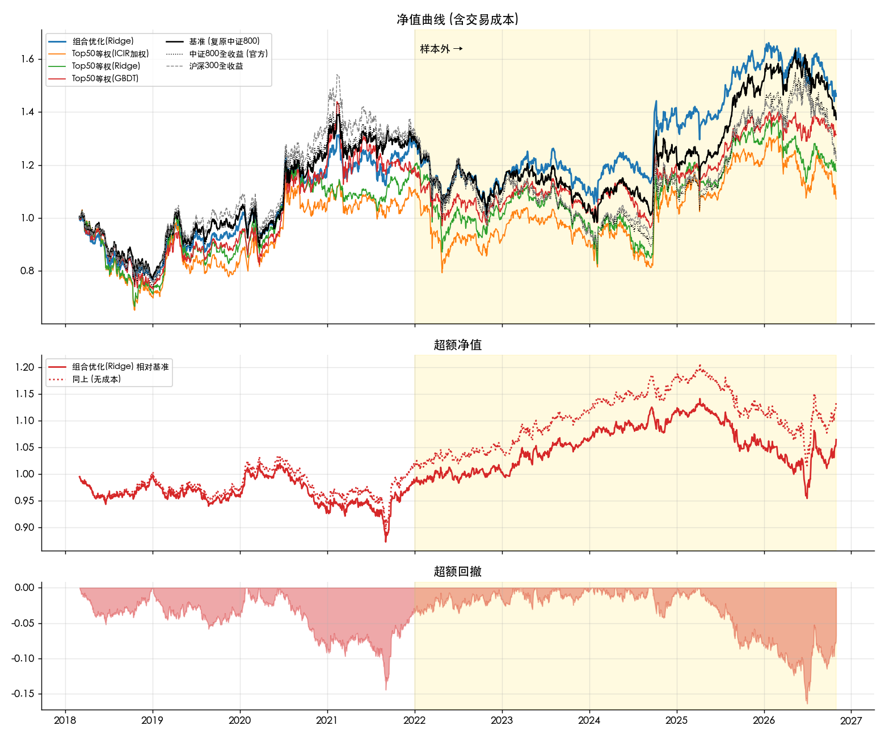

# A股多因子选股与动态组合优化

**A-share multi-factor stock selection & risk-constrained portfolio optimisation (CSI 800, monthly)**

这是一个完整的端到端量化研究框架，按顺序包括六步：

1. 时点数据获取与质量审计
2. 19 个因子的构建与检验
3. Walk-forward 选股模型
4. Barra 式风险模型与 cvxpy 组合优化
5. 含 A 股交易限制的日频回测
6. 样本外验证，以及 Brinson 和因子归因



## 核心结果

调仓频率为月度，回测含交易成本，基准是时点中证800的全收益。

| 组合优化 (Ridge) | 年化收益 | 超额年化 | 跟踪误差 | 信息比率 | 最大回撤 | 年化换手 | 超额 vs 官方中证800全收益 |
|---|---|---|---|---|---|---|---|
| 样本内 2018-02 ~ 2021-12 | 6.99% | −0.44% | 6.0% | −0.07 | −24.4% | 236% | −0.74% |
| **样本外 2022-01 ~ 2026-10** | **2.80%** | **+1.73%** | 6.2% | **0.28** | −21.8% | 229% | **+4.70%** |

- **信号稳定**：Ridge 合成信号的样本外 RankIC 为 0.057，年化 ICIR 为 1.49，和样本内的 1.57 相当。
- **优化有明显增益**：与同一信号的 Top50 等权相比，换手从 690% 降到 230%，成本从 2.2% 降到 0.7%，样本外 IR 从 −0.13 提高到 0.28。
- **long-only 吃掉了大部分信息**：信号主要用于识别输家，但多头组合最多只能减配到 0，转移系数只有 0.30。组合因此带有低 Beta、低波动的风格依赖。详细分析见 [研究报告](reports/research_report.md)。

## 方法要点（防偏差设计）

| 环节 | 做法 |
|---|---|
| 幸存者偏差 | 股票池采用每月的沪深300 + 中证500成分股快照 |
| 财报前视 | 财报按公告日的**次日**起使用；首次披露日按 min(最新公告日, 法定截止日) 估计；每股指标随送转股调整（有单元测试） |
| 复权 | 后复权因子推导 preclose，总收益包含分红送转；与 baostock 交叉验证，99.95% 的日收益误差小于 0.1pp |
| 标签泄漏 | Walk-forward 训练与预测之间留 1 个月 gap（有单元测试） |
| 过拟合 | 因子、模型、λ 只在样本内选择，样本外只评估一次 |
| 交易现实 | T+1 VWAP 成交；一字板和停牌不可交易；佣金、滑点、分段印花税 |
| 基准 | 使用全收益指数（组合收益也含分红）；同时给出复原基准和官方指数两个口径 |

## 项目结构

```
config.yaml                 全部参数：样本切分、过滤、模型、约束、成本
src/mf/
  data_fetch_ak.py          新浪日线 + 复权因子、东方财富季报、中证全收益指数（限速、退避、断点续传）
  data_fetch.py             baostock：时点成分股、行业、上市日期、价格指数
  panel.py                  日频面板、ST 推断、涨跌停、时点基本面、复原基准
  data_audit.py             数据质量审计与跨源交叉验证
  factors.py                19 个因子 + 预处理（MAD、标准化、行业/市值中性）
  dataset.py                月度截面、T+1 VWAP 标签、可交易标记
  factor_test.py            RankIC、ICIR、分组、IC 衰减、自相关、因子筛选
  models.py                 ICIR 加权 / Ridge / GBDT 的 walk-forward 训练
  risk.py                   行业 + 6 风格因子的 WLS 截面回归，EWMA 协方差
  optimizer.py              cvxpy 均值-方差主动优化
  backtest.py               日频回测引擎
  metrics.py, attribution.py  绩效指标、Brinson 与因子归因
scripts/01 … 06             六个流程步骤
tests/test_core.py          9 个单元测试（前视、时点、成本、涨跌停、优化器）
reports/                    研究报告、审计、因子检验、回测结果、图表
docs/                       学习指南、面试手册、简历表述
```

## 复现

```bash
python3 -m venv .venv && .venv/bin/pip install -r requirements.txt
bash run_all.sh     # 首次运行约 50 分钟（下载数据），之后约 4 分钟
```

数据来自 [AkShare](https://github.com/akfamily/akshare)（新浪、东方财富、中证指数）和 [baostock](http://baostock.com)，仅用于研究，不在仓库中分发。

## 报告

- [研究报告](reports/research_report.md)：方法、结果、归因、局限，以及研究中发现并修正的 6 个问题
- [数据审计](reports/data_audit.md) · [单因子检验](reports/factor_tests.md) · [回测结果明细](reports/results.md)
- [学习指南](docs/learning_guide.md) · [面试手册](docs/interview_guide.md)

## 局限

- 79 只退市股票缺少数据，存在残余的幸存者偏差。
- 行业分类不是时点数据。
- 财报首次披露日是估计值。
- ST 状态是推断值。
- 没有建模冲击成本与策略容量。

详见报告第 1.4 节和第 7 节。
