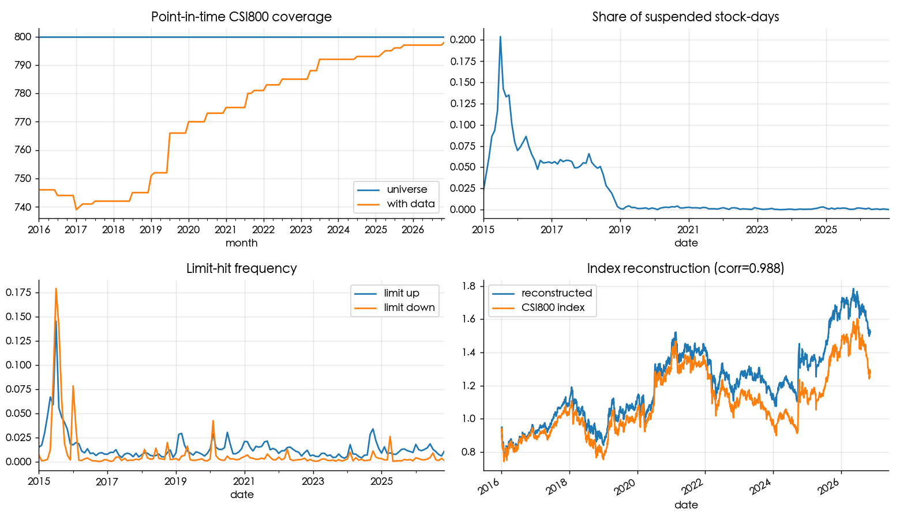

# 数据质量审计报告 (Data Quality Audit)

- 数据源: 新浪日线 (不复权 + 后复权因子) / 东方财富季度业绩报表 (含公告日) / baostock (股票池、行业、上市日期、指数); 样本 2015-01-01 ~ 2026-11-11
- 股票池: 每月时点 CSI800 成分股 (沪深300 + 中证500), 共 1517 只出现过; 有数据 1437 只
- 总记录数: 3,666,086

| 检查项 | 结果 | 处理方式 |
|---|---|---|
| 缺失股票 | 80 只 ['sh.600005', 'sh.600068', 'sh.600074', 'sh.600086', 'sh.600112'] | 剔除 |
| 重复 (code,date) | 0 | 保留最后一条 |
| 非交易日记录 | 0 | 剔除 |
| 交易日缺口 (上市后缺失日) | 0 只 / 0 个股票日 | 视作停牌, 收益记 0 |
| OHLC 不一致 (low>open/close 等) | 0 | 标记, 不用于开高低价因子 |
| 除权除息日 (复权因子变化) | 13,538 | preclose = 前收 × f(t-1)/f(t) |
| 超出涨跌幅限制的收益 | 279 (剔除上市前5日后 260) | 新股过滤 (上市<250日剔除) |
| 停牌股票日占比 | 1.97% | 调仓日停牌不可买卖 |
| ST 股票日占比 | 1.31% | 剔除 |
| 涨停 / 跌停 占比 | 1.34% / 0.64% | 涨停不可买、跌停不可卖 |
| 一字板天数 | 8,157 | 不可交易 |
| EP / BP / SP / ROE / 净利同比 缺失 | 0.08% / 0.44% / 0.19% / 0.47% / 0.08% | 行业中位数填充 |
| 换手率缺失 | 0.00% | — |
| 负 EP (亏损) 占比 | 12.83% | 用 EP 而非 PE, 保持单调 |
| 财报滞后 (交易日 - 报告期, 中位数) | 115 天 | 按公告日对齐, 公告次日起可用 |
| 股票池中后来退市的股票 | 79 只 | 新浪无退市股数据 → 残余幸存者偏差 (见局限) |
| 行业缺失 | 0.00% | 归入 '未分类' |

## 跨数据源交叉验证 (新浪 vs baostock)
在两个数据源都有的 180 只股票、447,920 个股票日上: 收盘价一致率 **99.80%**, 日收益误差<0.1pp 的比例 **99.96%**, 收益相关系数 **0.9993**。
ST 推断 (近60日收盘/最高/最低触及±5%涨跌停价≥3次, 且无>5.5%波动; 参数在该样本上网格搜索) 对照 baostock 真实 ST 标记: 精确率 **82.23%**, 召回率 **70.10%** (真实 ST 占比 1.23%)。按股票代码随机分成两半: A 半精确率 / 召回率 86.04% / 76.03%, B 半 77.16% / 62.83%。注意: 推断参数是在整个样本上网格搜索得到的, 这只是稳定性检查, **不是独立持出样本**; 独立验证需要另一批从未参与调参的股票的真实 ST 记录, 目前没有。

## 指数复原检验
用成分股流通市值加权 (含分红) 收益复原中证800, 对比官方中证800全收益指数 (H00906): 日收益相关系数 **0.9881**, 年化跟踪误差 3.41%。 相关系数接近 1 说明收益、市值、成分股数据整体可信; 但两者每年有 3-5% 的系统性差异, 主要因为官方指数用**自由流通市值** (剔除控股股东等战略持股) 加权并分级靠档, 而这里只有流通市值, 大型国企 (银行、石油等) 权重被高估。逐年差异 (复原 − 官方): 2016: +2.7%, 2017: +3.0%, 2018: +4.0%, 2019: -5.3%, 2020: -3.5%, 2021: +1.6%, 2022: +3.8%, 2023: +4.0%, 2024: +3.1%, 2025: -2.5%, 2026: +1.7%。
**处理**: 组合优化器的基准权重就是流通市值权重, 所以策略 alpha 以复原基准衡量 (主口径), 同时报告相对官方全收益指数的超额 (副口径); 两者之差是基准构造差异, 不是选股能力。

## 已知局限
- 行业分类为 baostock 提供的当前证监会行业分类 (二级, 约 76 个; 非时点数据), 存在轻微前视偏差;
- 新浪不提供已退市股票数据: 股票池中已退市股票缺失, 存在残余幸存者偏差 (会轻微高估收益);
- ST 为推断值 (见交叉验证), 创业板/科创板 20% 涨跌幅下无法识别 ST;
- 东方财富报表只给'最新公告日期' (常为次年年报重述比较数据的日期), 首次披露日按 min(最新公告日, 法定截止日) 估计 (一季报 4/30, 半年报 8/31, 三季报 10/31, 年报次年 4/30); 对逾期披露的极少数公司存在轻微前视;
- 报表数值可能是重述后的数值而非首次披露值, 存在轻微前视。

