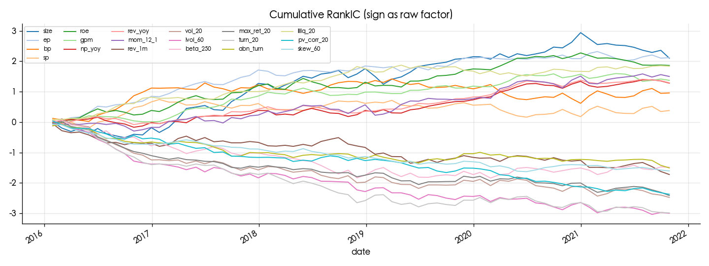
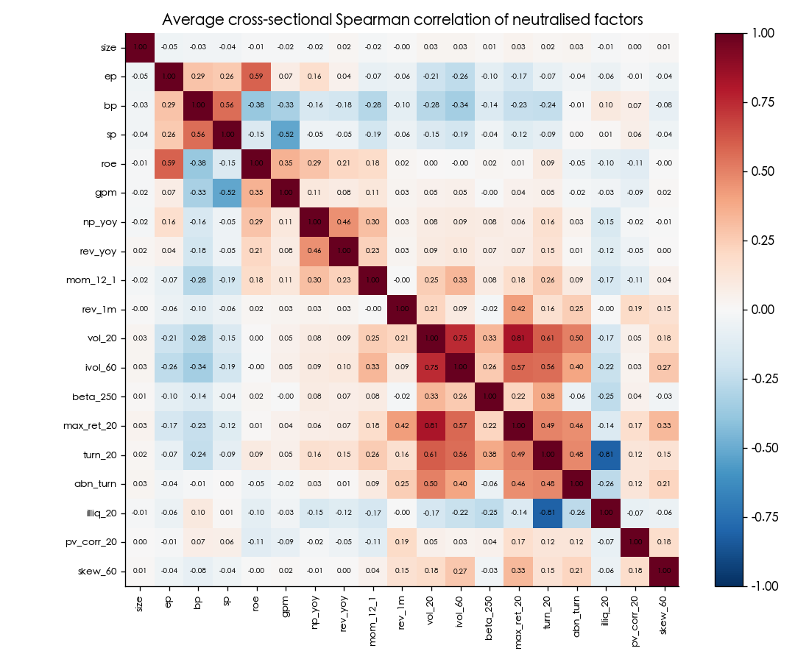
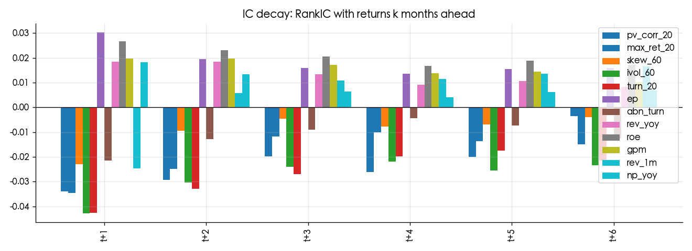
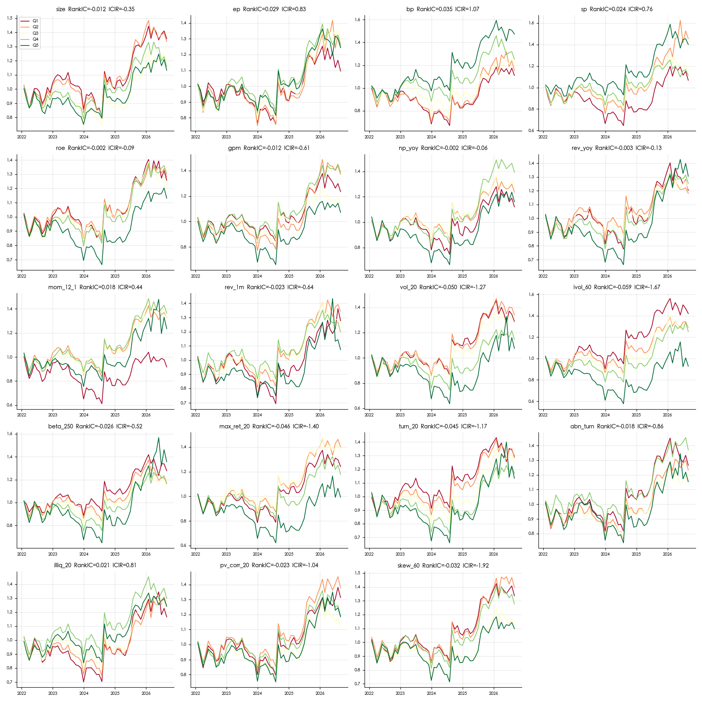

# 单因子检验 (Single-Factor Tests)

预处理: 行业中位数填充 → MAD(5倍) 去极值 → Z-score → 对证监会行业哑变量 + ln流通市值 回归取残差 (市值因子仅行业中性) → Z-score。
检验: 月末截面 RankIC (Spearman), 标签为 T+1 日 VWAP 买入、持有至下月末 T+1 VWAP 的收益; 五分组等权月度收益。
时间口径: 一个信号日只有在其标签**完全实现** (下一次调仓的成交日) 不晚于区间终点时才计入该区间。样本内最后一个可用信号日是 2021-10-29 (标签实现于 2021-12-01); 之后的信号日标签在 2021-12-31 之后才实现, 不进入样本内的任何决策。

## 因子定义

| 因子 | 类别 | 定义 |
|---|---|---|
| size | Size | ln(流通市值) |
| ep | Value | EPS_TTM / 价格 (财报按公告日对齐, 复权因子调整股本) |
| bp | Value | 每股净资产 / 价格 |
| sp | Value | 每股营收_TTM / 价格 |
| roe | Quality | 净利润_TTM / 净资产 |
| gpm | Quality | 销售毛利率 |
| np_yoy | Growth | 净利润同比增速 (最新财报) |
| rev_yoy | Growth | 营业收入同比增速 (最新财报) |
| mom_12_1 | Momentum | 过去12个月收益, 剔除最近1个月 |
| rev_1m | Reversal | 过去1个月收益 |
| vol_20 | Volatility | 20日收益波动率 |
| ivol_60 | Volatility | 60日特质波动率 (对中证800回归残差) |
| beta_250 | Volatility | 250日市场Beta |
| max_ret_20 | Volatility | 20日最大单日收益 (彩票效应) |
| turn_20 | Liquidity | ln(20日平均换手率) |
| abn_turn | Liquidity | 20日均换手 / 250日均换手 |
| illiq_20 | Liquidity | ln(Amihud 非流动性 |r|/成交额, 20日) |
| pv_corr_20 | PriceVol | 20日 收盘价-成交量 相关系数 |
| skew_60 | PriceVol | 60日收益偏度 |

## 样本内 2016-01-01 ~ 2021-12-31

| 因子         | 类别         |   IC均值 |   ICIR(年化) |     t值 |   IC>0占比 |   多空年化 |   多空夏普 |   单调性 |   因子自相关 |
|:-----------|:-----------|-------:|-----------:|-------:|---------:|-------:|-------:|------:|--------:|
| size       | Size       |  0.03  |      0.707 |  1.707 |    0.586 |  0.048 |  0.446 |   0.7 |   0.988 |
| ep         | Value      |  0.03  |      1.298 |  3.135 |    0.614 |  0.037 |  0.544 |   0.3 |   0.952 |
| bp         | Value      |  0.014 |      0.444 |  1.073 |    0.5   | -0.01  | -0.054 |  -0.5 |   0.98  |
| sp         | Value      |  0.005 |      0.2   |  0.483 |    0.557 | -0.025 | -0.222 |  -0.7 |   0.984 |
| roe        | Quality    |  0.027 |      1.027 |  2.48  |    0.586 |  0.042 |  0.527 |   0.9 |   0.963 |
| gpm        | Quality    |  0.02  |      0.959 |  2.317 |    0.586 |  0.05  |  0.707 |   1   |   0.98  |
| np_yoy     | Growth     |  0.018 |      0.877 |  2.118 |    0.629 |  0.073 |  0.963 |   1   |   0.879 |
| rev_yoy    | Growth     |  0.018 |      1.072 |  2.589 |    0.6   |  0.055 |  0.897 |   0.9 |   0.905 |
| mom_12_1   | Momentum   |  0.021 |      0.684 |  1.651 |    0.586 |  0.103 |  0.882 |   0.9 |   0.87  |
| rev_1m     | Reversal   | -0.025 |     -0.897 | -2.166 |    0.443 |  0.024 |  0.309 |   0.8 |   0.039 |
| vol_20     | Volatility | -0.035 |     -1.163 | -2.81  |    0.357 | -0.006 | -0.012 |  -0.1 |   0.516 |
| ivol_60    | Volatility | -0.043 |     -1.466 | -3.542 |    0.3   |  0.026 |  0.325 |   0.1 |   0.833 |
| beta_250   | Volatility | -0.021 |     -0.71  | -1.714 |    0.457 | -0.017 | -0.156 |  -0   |   0.961 |
| max_ret_20 | Volatility | -0.034 |     -1.56  | -3.769 |    0.329 |  0.006 |  0.125 |   0.6 |   0.286 |
| turn_20    | Liquidity  | -0.043 |     -1.46  | -3.526 |    0.343 |  0.024 |  0.29  |   0.5 |   0.834 |
| abn_turn   | Liquidity  | -0.022 |     -1.104 | -2.667 |    0.386 |  0.013 |  0.245 |  -0   |   0.611 |
| illiq_20   | Liquidity  |  0.026 |      1.247 |  3.013 |    0.643 |  0.028 |  0.422 |   0.9 |   0.826 |
| pv_corr_20 | PriceVol   | -0.034 |     -1.809 | -4.369 |    0.286 |  0.079 |  1.244 |   0.9 |   0.155 |
| skew_60    | PriceVol   | -0.023 |     -1.487 | -3.592 |    0.329 |  0.038 |  0.818 |   0.8 |   0.567 |

**入选因子** (|t|≥2, |ICIR|≥0.5, 两两相关<0.6, 按 |ICIR| 贪心): pv_corr_20(−), max_ret_20(−), skew_60(−), ivol_60(−), turn_20(−), ep(+), abn_turn(−), rev_yoy(+), roe(+), gpm(+), rev_1m(−), np_yoy(+)

## 样本外 2022-01-01 ~ 2026-10-31 (仅展示, 未参与筛选)

| 因子         | 类别         |   IC均值 |   ICIR(年化) |     t值 |   IC>0占比 |   多空年化 |   多空夏普 |   单调性 |   因子自相关 |
|:-----------|:-----------|-------:|-----------:|-------:|---------:|-------:|-------:|------:|--------:|
| size       | Size       | -0.012 |     -0.348 | -0.752 |    0.482 |  0.041 |  0.398 |   1   |   0.987 |
| ep         | Value      |  0.029 |      0.829 |  1.79  |    0.679 |  0.014 |  0.171 |   0.1 |   0.959 |
| bp         | Value      |  0.035 |      1.074 |  2.32  |    0.679 |  0.048 |  0.458 |   0.9 |   0.986 |
| sp         | Value      |  0.024 |      0.757 |  1.635 |    0.643 |  0.042 |  0.414 |   0.3 |   0.988 |
| roe        | Quality    | -0.002 |     -0.089 | -0.192 |    0.482 |  0.019 |  0.247 |   0.4 |   0.97  |
| gpm        | Quality    | -0.012 |     -0.608 | -1.313 |    0.411 |  0.018 |  0.261 |   0.3 |   0.986 |
| np_yoy     | Growth     | -0.002 |     -0.064 | -0.138 |    0.482 | -0.011 | -0.103 |  -0.4 |   0.886 |
| rev_yoy    | Growth     | -0.003 |     -0.132 | -0.286 |    0.446 | -0.023 | -0.223 |  -0.4 |   0.914 |
| mom_12_1   | Momentum   |  0.018 |      0.439 |  0.949 |    0.554 |  0.042 |  0.321 |   0.3 |   0.878 |
| rev_1m     | Reversal   | -0.023 |     -0.642 | -1.388 |    0.464 |  0.022 |  0.208 |   0.9 |   0.045 |
| vol_20     | Volatility | -0.05  |     -1.27  | -2.743 |    0.304 | -0.007 |  0.065 |   0.8 |   0.539 |
| ivol_60    | Volatility | -0.059 |     -1.666 | -3.599 |    0.286 |  0.055 |  0.377 |   1   |   0.85  |
| beta_250   | Volatility | -0.026 |     -0.518 | -1.119 |    0.429 | -0.069 | -0.212 |  -0.3 |   0.967 |
| max_ret_20 | Volatility | -0.046 |     -1.405 | -3.035 |    0.321 |  0.023 |  0.223 |   0.7 |   0.326 |
| turn_20    | Liquidity  | -0.045 |     -1.165 | -2.517 |    0.375 | -0.011 |  0.034 |   0.7 |   0.863 |
| abn_turn   | Liquidity  | -0.018 |     -0.86  | -1.858 |    0.411 |  0.007 |  0.116 |   0.2 |   0.588 |
| illiq_20   | Liquidity  |  0.021 |      0.809 |  1.748 |    0.643 | -0.004 |  0.017 |   0.3 |   0.858 |
| pv_corr_20 | PriceVol   | -0.023 |     -1.035 | -2.236 |    0.429 |  0.016 |  0.204 |   0.5 |   0.151 |
| skew_60    | PriceVol   | -0.032 |     -1.925 | -4.157 |    0.304 |  0.034 |  0.531 |   0.6 |   0.577 |

