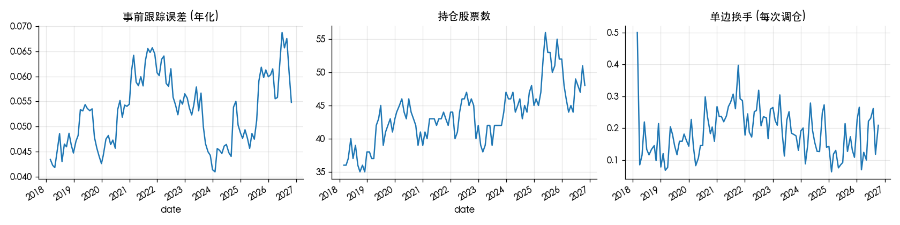
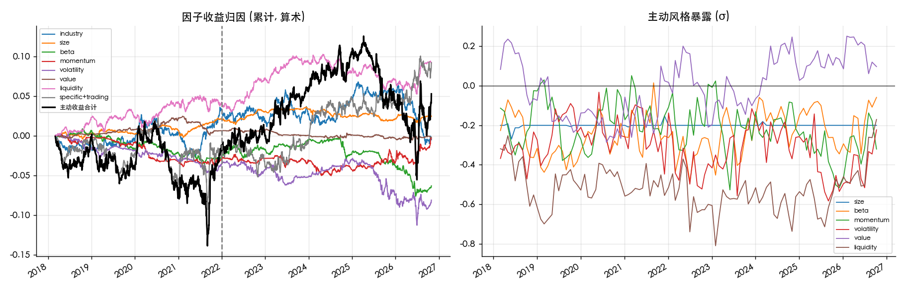

# 回测与归因结果 (自动生成)

- 选股模型 (样本内 ICIR 最优): **Ridge**; 风险厌恶系数 (样本内 IR 最优): **λ=2.0**
- 基准 (主口径): 时点中证800成分股按流通市值加权的全收益 (= 优化器跟踪的基准); 副口径: 官方中证800全收益指数 H00906, 见 '超额年化(vs官方全收益)' 一行
- 预测区间: 2018-02-28 起 (前 24 个月仅用于训练); 样本外: 2022-01-01 ~ 2026-10-31
- 成本: 佣金万2.5 双边 + 滑点千1 双边 + 印花税 (2023-08-28 前千1, 之后万5, 仅卖出)

## 模型预测能力

| 模型     | 区间   |   RankIC |   ICIR(年化) |   IC>0占比 |   Top10%月均超额 |    多空年化 |
|:-------|:-----|---------:|-----------:|---------:|-------------:|--------:|
| ICIR加权 | IS   |   0.0336 |     1.5338 |   0.7234 |      -0.0023 |  0.0206 |
| ICIR加权 | OOS  |   0.064  |     1.926  |   0.6964 |       0.0011 |  0.0023 |
| Ridge  | IS   |   0.043  |     1.5731 |   0.6596 |      -0.0018 |  0.0174 |
| Ridge  | OOS  |   0.0571 |     1.4926 |   0.6607 |      -0.0007 | -0.0237 |
| GBDT   | IS   |   0.0526 |     1.402  |   0.6596 |       0      |  0.0494 |
| GBDT   | OOS  |   0.0683 |     1.3273 |   0.6071 |       0.0011 |  0.0227 |

## 风险厌恶系数校准 (仅样本内)

|    | ex_ante_te   |     IR | 超额年化   | 跟踪误差   |     持仓数 |
|---:|:-------------|-------:|:-------|:-------|--------:|
|  2 | 5.19%        | -0.074 | -0.44% | 6.00%  |  40.915 |
| 10 | 3.46%        | -0.429 | -1.89% | 4.40%  |  88.468 |
| 50 | 1.45%        | -0.395 | -0.90% | 2.29%  | 250.532 |

## 绩效 — 样本内 IS

|                 | 年化收益   | 年化波动   |   夏普比率 | 最大回撤    |   卡玛比率 | 基准年化   | 超额年化   | 跟踪误差   | 信息比率   | 超额最大回撤   | 月度胜率   | 年化单边换手   | 年化成本拖累   | 超额年化(vs官方全收益)   |
|:----------------|:-------|:-------|-------:|:--------|-------:|:-------|:-------|:-------|:-------|:---------|:-------|:---------|:---------|:----------------|
| 组合优化(Ridge)     | 6.99%  | 18.07% |   0.39 | -24.44% |   0.29 | 7.46%  | -0.44% | 6.00%  | -0.07  | -14.43%  | 50.00% | 236.40%  | 0.81%    | -0.74%          |
| Top50等权(ICIR加权) | 2.76%  | 20.52% |   0.13 | -36.80% |   0.08 | 7.46%  | -4.37% | 9.30%  | -0.47  | -23.97%  | 41.30% | 728.94%  | 2.54%    | -4.66%          |
| Top50等权(Ridge)  | 4.92%  | 19.59% |   0.25 | -35.02% |   0.14 | 7.46%  | -2.36% | 9.67%  | -0.24  | -21.48%  | 47.83% | 660.58%  | 2.30%    | -2.66%          |
| Top50等权(GBDT)   | 4.88%  | 20.80% |   0.23 | -28.27% |   0.17 | 7.46%  | -2.40% | 6.95%  | -0.35  | -13.56%  | 39.13% | 544.65%  | 1.89%    | -2.70%          |
| 组合优化(Ridge) 无成本 | 7.86%  | 18.08% |   0.43 | -24.19% |   0.33 | 7.46%  | 0.37%  | 6.00%  | 0.06   | -13.36%  | 50.00% | 236.40%  | 0.00%    | 0.07%           |
| 基准: 复原中证800     | 7.46%  | 19.11% |   0.39 | -24.78% |   0.3  | -      | -      | -      | -      | -        | -      | -        | -        | -               |
| 中证800全收益(官方)    | 7.79%  | 20.63% |   0.38 | -28.45% |   0.27 | -      | -      | -      | -      | -        | -      | -        | -        | -               |

## 绩效 — 样本外 OOS

|                 | 年化收益   | 年化波动   |   夏普比率 | 最大回撤    |   卡玛比率 | 基准年化   | 超额年化   | 跟踪误差   | 信息比率   | 超额最大回撤   | 月度胜率   | 年化单边换手   | 年化成本拖累   | 超额年化(vs官方全收益)   |
|:----------------|:-------|:-------|-------:|:--------|-------:|:-------|:-------|:-------|:-------|:---------|:-------|:---------|:---------|:----------------|
| 组合优化(Ridge)     | 2.80%  | 15.51% |   0.18 | -21.76% |   0.13 | 1.05%  | 1.73%  | 6.23%  | 0.28   | -16.39%  | 51.72% | 229.39%  | 0.74%    | 4.70%           |
| Top50等权(ICIR加权) | -0.69% | 19.37% |  -0.04 | -28.44% |  -0.02 | 1.05%  | -1.72% | 9.81%  | -0.18  | -25.47%  | 48.28% | 774.40%  | 2.48%    | 1.15%           |
| Top50等权(Ridge)  | -0.35% | 18.76% |  -0.02 | -31.55% |  -0.01 | 1.05%  | -1.38% | 10.29% | -0.13  | -24.91%  | 48.28% | 692.16%  | 2.21%    | 1.50%           |
| Top50等权(GBDT)   | 2.10%  | 15.55% |   0.14 | -18.68% |   0.11 | 1.05%  | 1.04%  | 7.29%  | 0.14   | -20.57%  | 50.00% | 672.03%  | 2.13%    | 4.00%           |
| 组合优化(Ridge) 无成本 | 3.56%  | 15.52% |   0.23 | -21.18% |   0.17 | 1.05%  | 2.48%  | 6.22%  | 0.40   | -15.84%  | 51.72% | 229.39%  | 0.00%    | 5.48%           |
| 基准: 复原中证800     | 1.05%  | 16.56% |   0.06 | -24.68% |   0.04 | -      | -      | -      | -      | -        | -      | -        | -        | -               |
| 中证800全收益(官方)    | -1.82% | 18.86% |  -0.1  | -33.22% |  -0.05 | -      | -      | -      | -      | -        | -      | -        | -        | -               |

## 分年度 — 组合优化(Ridge)

|   date | 策略      | 基准      | 超额     |
|-------:|:--------|:--------|:-------|
|   2018 | -22.58% | -22.09% | -0.63% |
|   2019 | 26.67%  | 31.21%  | -3.46% |
|   2020 | 21.56%  | 24.75%  | -2.56% |
|   2021 | 7.79%   | 2.44%   | 5.23%  |
|   2022 | -14.06% | -15.70% | 1.95%  |
|   2023 | 1.33%   | -4.31%  | 5.89%  |
|   2024 | 24.72%  | 18.48%  | 5.26%  |
|   2025 | 14.14%  | 21.45%  | -6.02% |
|   2026 | -8.34%  | -9.59%  | 1.38%  |

## Brinson 行业归因 (年化, 算术加总)

|         | allocation   | selection   | interaction   | 合计    |
|:--------|:-------------|:------------|:--------------|:------|
| 样本内 IS  | 1.13%        | -2.14%      | 1.33%         | 0.32% |
| 样本外 OOS | -0.52%       | 3.19%       | -0.69%        | 1.98% |

样本外分行业 (累计):

| industry                | allocation   | selection   | total   |
|:------------------------|:-------------|:------------|:--------|
| B07石油和天然气开采业            | -3.59%       | 1.02%       | -2.57%  |
| C39计算机、通信和其他电子设备制造业     | 1.47%        | -3.81%      | -2.33%  |
| C37铁路、船舶、航空航天和其他运输设备制造业 | -1.37%       | -0.01%      | -1.38%  |
| I64互联网和相关服务             | -0.51%       | -0.48%      | -0.98%  |
| J68保险业                  | -0.61%       | -0.28%      | -0.89%  |
| C15酒、饮料和精制茶制造业          | 1.51%        | 0.90%       | 2.40%   |
| J66货币金融服务               | -2.17%       | 4.65%       | 2.48%   |
| C26化学原料和化学制品制造业         | 0.05%        | 2.87%       | 2.93%   |
| C38电气机械和器材制造业           | -0.20%       | 3.71%       | 3.51%   |
| B06煤炭开采和洗选业             | 2.94%        | 0.57%       | 3.51%   |

## 因子收益归因 (年化主动收益贡献)

|         | industry   | size   | beta   | momentum   | volatility   | value   | liquidity   | active   | specific+trading   |
|:--------|:-----------|:-------|:-------|:-----------|:-------------|:--------|:------------|:---------|:-------------------|
| 样本内 IS  | 0.91%      | 0.57%  | -0.73% | -0.82%     | -0.96%       | 0.16%   | 1.13%       | -0.51%   | -0.77%             |
| 样本外 OOS | -0.84%     | 0.07%  | -0.78% | 0.58%      | -0.98%       | -0.18%  | 1.07%       | 1.55%    | 2.61%              |

