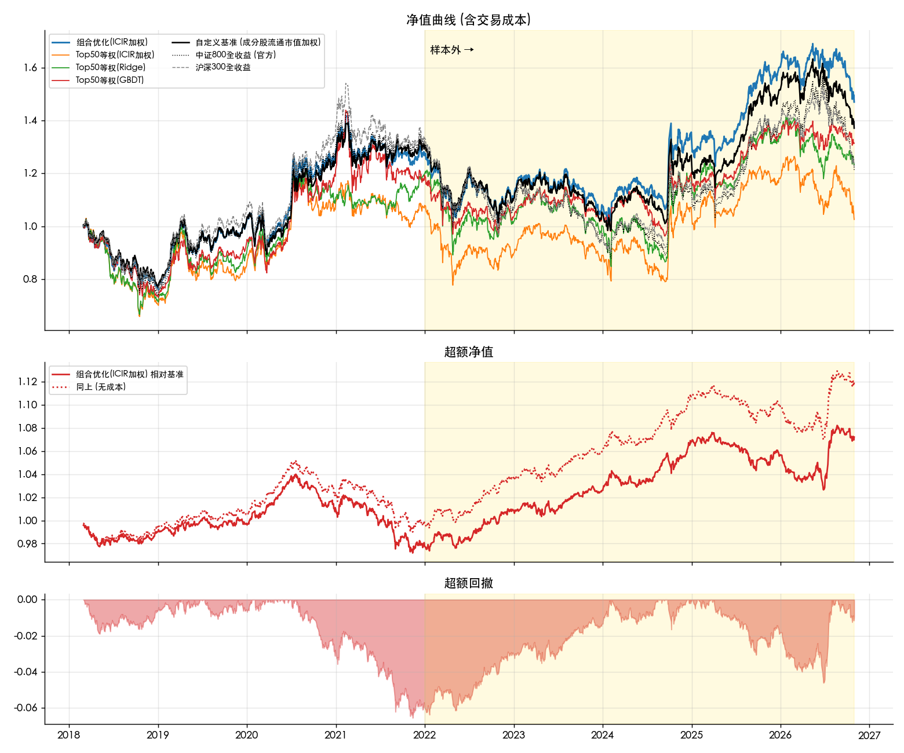

# 回测与归因结果 (自动生成)

- 选股模型 (样本内 ICIR 最优): **ICIR加权**; 风险厌恶系数 (样本内 IR 最优): **λ=50.0**
- **基准口径**: 本项目是**自定义流通市值基准增强**, 不是官方中证800指数增强。主基准 = 时点中证800成分股按 (前一日) 流通市值加权的全收益, 即优化器跟踪的组合; 官方指数用自由流通市值、分级靠档和权重上限, 历史成分权重无法免费获取。官方中证800全收益 (H00906) 只作副口径, 见 '超额年化(vs官方全收益)' 一列和下方基准对比表。
- 夏普比率 = (日收益均值 − 无风险利率/252) × 252 / 年化波动, 无风险利率 1.5%; 信息比率 = 日主动收益均值 × 252 / 跟踪误差 (算术口径); 年化收益与超额为几何口径
- 预测区间: 2018-02-28 起 (前 24 个月仅用于训练); 样本外: 2022-01-01 ~ 2026-10-31
- 成本: 佣金万2.5 双边 + 滑点千1 双边 + 印花税 (2023-08-28 前千1, 之后万5, 仅卖出)

## 模型预测能力

| 模型     | 区间   |   RankIC |   ICIR(年化) |   IC>0占比 |   Top10%月均超额 |    多空年化 |
|:-------|:-----|---------:|-----------:|---------:|-------------:|--------:|
| ICIR加权 | IS   |   0.0324 |     1.4386 |   0.6222 |      -0.0009 |  0.0146 |
| ICIR加权 | OOS  |   0.0642 |     1.9679 |   0.6964 |       0.0012 |  0.0032 |
| Ridge  | IS   |   0.0366 |     1.4281 |   0.6667 |      -0.0023 | -0.0006 |
| Ridge  | OOS  |   0.0565 |     1.49   |   0.6607 |      -0.0011 | -0.0218 |
| GBDT   | IS   |   0.0485 |     1.2898 |   0.6444 |      -0.0001 |  0.0399 |
| GBDT   | OOS  |   0.0683 |     1.3273 |   0.6071 |       0.0011 |  0.0227 |

## 风险厌恶系数校准 (仅样本内)

|    | ex_ante_te   |     IR | 超额年化   | 跟踪误差   |     持仓数 |
|---:|:-------------|-------:|:-------|:-------|--------:|
|  2 | 5.23%        | -0.468 | -2.75% | 5.94%  |  41.723 |
| 10 | 3.56%        | -0.425 | -1.73% | 4.19%  |  83.319 |
| 50 | 1.53%        | -0.292 | -0.60% | 2.15%  | 243.894 |

## 绩效 — 样本内 IS

|                  | 年化收益   | 年化波动   |   夏普比率 | 最大回撤    |   卡玛比率 | 基准年化   | 超额年化   | 跟踪误差   | 信息比率   | 超额最大回撤   | 月度胜率   | 年化单边换手   | 年化成本拖累   | 超额年化(vs官方全收益)   |
|:-----------------|:-------|:-------|-------:|:--------|-------:|:-------|:-------|:-------|:-------|:---------|:-------|:---------|:---------|:----------------|
| 组合优化(ICIR加权)     | 6.81%  | 18.98% |   0.36 | -24.91% |   0.27 | 7.46%  | -0.60% | 2.15%  | -0.29  | -6.55%   | 47.83% | 150.74%  | 0.51%    | -0.90%          |
| Top50等权(ICIR加权)  | 2.08%  | 20.58% |   0.13 | -36.11% |   0.06 | 7.46%  | -5.01% | 9.24%  | -0.52  | -23.50%  | 39.13% | 696.19%  | 2.42%    | -5.30%          |
| Top50等权(Ridge)   | 5.02%  | 19.64% |   0.27 | -35.13% |   0.14 | 7.46%  | -2.27% | 9.67%  | -0.23  | -20.43%  | 50.00% | 670.63%  | 2.33%    | -2.57%          |
| Top50等权(GBDT)    | 4.88%  | 20.80% |   0.26 | -28.27% |   0.17 | 7.46%  | -2.40% | 6.95%  | -0.30  | -13.56%  | 39.13% | 544.65%  | 1.89%    | -2.70%          |
| 组合优化(ICIR加权) 无成本 | 7.36%  | 18.99% |   0.39 | -24.68% |   0.3  | 7.46%  | -0.09% | 2.14%  | -0.05  | -5.84%   | 50.00% | 150.74%  | 0.00%    | -0.39%          |
| 自定义基准(成分股流通市值加权) | 7.46%  | 19.11% |   0.39 | -24.78% |   0.3  | -      | -      | -      | -      | -        | -      | -        | -        | -               |
| 中证800全收益(官方)     | 7.79%  | 20.63% |   0.39 | -28.45% |   0.27 | -      | -      | -      | -      | -        | -      | -        | -        | -               |

## 绩效 — 样本外 OOS

|                  | 年化收益   | 年化波动   |   夏普比率 | 最大回撤    |   卡玛比率 | 基准年化   | 超额年化   | 跟踪误差   | 信息比率   | 超额最大回撤   | 月度胜率   | 年化单边换手   | 年化成本拖累   | 超额年化(vs官方全收益)   |
|:-----------------|:-------|:-------|-------:|:--------|-------:|:-------|:-------|:-------|:-------|:---------|:-------|:---------|:---------|:----------------|
| 组合优化(ICIR加权)     | 3.08%  | 16.43% |   0.18 | -21.30% |   0.14 | 1.05%  | 2.01%  | 2.17%  | 0.91   | -4.61%   | 65.52% | 163.94%  | 0.53%    | 4.99%           |
| Top50等权(ICIR加权)  | -1.09% | 19.38% |  -0.04 | -27.85% |  -0.04 | 1.05%  | -2.12% | 9.71%  | -0.17  | -25.49%  | 48.28% | 770.54%  | 2.46%    | 0.74%           |
| Top50等权(Ridge)   | 0.62%  | 18.86% |   0.05 | -30.09% |   0.02 | 1.05%  | -0.42% | 10.18% | -0.00  | -23.64%  | 50.00% | 702.12%  | 2.24%    | 2.49%           |
| Top50等权(GBDT)    | 2.10%  | 15.55% |   0.12 | -18.68% |   0.11 | 1.05%  | 1.04%  | 7.29%  | 0.12   | -20.57%  | 50.00% | 672.03%  | 2.13%    | 4.00%           |
| 组合优化(ICIR加权) 无成本 | 3.63%  | 16.45% |   0.21 | -21.14% |   0.17 | 1.05%  | 2.55%  | 2.16%  | 1.16   | -4.18%   | 67.24% | 163.94%  | 0.00%    | 5.55%           |
| 自定义基准(成分股流通市值加权) | 1.05%  | 16.56% |   0.06 | -24.68% |   0.04 | -      | -      | -      | -      | -        | -      | -        | -        | -               |
| 中证800全收益(官方)     | -1.82% | 18.86% |  -0.08 | -33.22% |  -0.05 | -      | -      | -      | -      | -        | -      | -        | -        | -               |

## 分年度 — 组合优化(ICIR加权)

|   date | 策略      | 基准      | 超额     |
|-------:|:--------|:--------|:-------|
|   2018 | -22.89% | -22.09% | -1.04% |
|   2019 | 32.24%  | 31.21%  | 0.79%  |
|   2020 | 26.27%  | 24.75%  | 1.22%  |
|   2021 | -0.78%  | 2.44%   | -3.14% |
|   2022 | -13.02% | -15.70% | 3.18%  |
|   2023 | -2.68%  | -4.31%  | 1.70%  |
|   2024 | 23.39%  | 18.48%  | 4.14%  |
|   2025 | 20.13%  | 21.45%  | -1.09% |
|   2026 | -8.27%  | -9.59%  | 1.46%  |

## 约束满足率 (实际成交后的持仓, 而非优化器目标)

优化器以实际持仓 (经过一个月涨跌、以及涨跌停/停牌导致的未成交) 为起点; 下表按实际成交后的持仓逐月检查约束。
不满足的月份来自: 一字跌停/停牌卖不出、已调出股票池但无法卖出的股票, 以及优化器为求可行而放宽约束的月份。

|         | 行业偏离满足率   | 市值暴露满足率   | 单票上限满足率   | 换手上限满足率   | 最大行业偏离   | 最大单边换手   | 平均单边换手   | 被迫持有(已出股票池)平均权重   |   调仓次数 |   最大市值暴露(σ) |
|:--------|:----------|:----------|:----------|:----------|:---------|:---------|:---------|:------------------|-------:|------------:|
| 样本内 IS  | 100.00%   | 93.48%    | 100.00%   | 97.83%    | 2.86%    | 50.00%   | 12.17%   | 0.02%             |     46 |       0.205 |
| 样本外 OOS | 100.00%   | 100.00%   | 100.00%   | 100.00%   | 5.00%    | 27.07%   | 13.09%   | 0.00%             |     58 |       0.189 |

## Brinson 行业归因 (年化, 算术加总)

|         | allocation   | selection   | interaction   | 合计     |
|:--------|:-------------|:------------|:--------------|:-------|
| 样本内 IS  | 0.56%        | -0.74%      | 0.11%         | -0.07% |
| 样本外 OOS | -0.13%       | 2.43%       | -0.04%        | 2.26%  |

样本外分行业 (累计, 含交互项):

| industry        | allocation   | selection   | interaction   | total   |
|:----------------|:-------------|:------------|:--------------|:--------|
| I64互联网和相关服务     | -0.23%       | -0.25%      | -0.46%        | -0.94%  |
| L72商务服务业        | -0.46%       | 0.15%       | -0.10%        | -0.40%  |
| G55水上运输业        | -0.23%       | -0.23%      | 0.10%         | -0.37%  |
| J68保险业          | -0.27%       | -0.06%      | 0.02%         | -0.31%  |
| C14食品制造业        | -0.27%       | 0.04%       | -0.06%        | -0.29%  |
| E48土木工程建筑业      | -0.04%       | 0.72%       | 0.04%         | 0.72%   |
| J67资本市场服务       | -0.07%       | 1.12%       | -0.25%        | 0.80%   |
| C27医药制造业        | 0.07%        | 1.09%       | 0.09%         | 1.25%   |
| C26化学原料和化学制品制造业 | -0.06%       | 1.68%       | 0.02%         | 1.64%   |
| C38电气机械和器材制造业   | 0.03%        | 2.23%       | 0.41%         | 2.67%   |

## 归因对账: 从 Brinson 到实际超额 (年化)

Brinson (含交互项) 精确解释的是 '调仓后权重买入持有一个月' 的组合相对 '信号日基准权重买入持有' 的超额。它与绩效表中的超额之间的差异逐项列出: Brinson合计 + 交易成本 + 调仓日执行时点差 + 基准口径差 = 实际超额 (期间算术加总); 再加上复利口径差 = 几何超额年化。

|         | Brinson合计(买入持有)   | 交易成本   | 调仓日执行时点差   | 基准口径差(日度再平衡 vs 月初权重)   | 实际超额(期间算术加总)   | 复利与日度/期间口径差   | 超额年化(几何, 绩效表口径)   |
|:--------|:------------------|:-------|:-----------|:-----------------------|:---------------|:--------------|:------------------|
| 样本内 IS  | -0.07%            | -0.50% | -0.08%     | 0.09%                  | -0.55%         | -0.05%        | -0.60%            |
| 样本外 OOS | 2.26%             | -0.52% | -0.14%     | 0.32%                  | 1.92%          | 0.09%         | 2.01%             |

## 因子收益归因 (年化主动收益贡献)

industry + 6 个风格 + cost (交易成本) + specific = active (按日精确对账)。specific 是风险模型解释不了的部分: 个股特异收益、月内权重漂移 (暴露按调仓日权重计算) 和调仓日执行时点。

|         | industry   | size   | beta   | momentum   | volatility   | value   | liquidity   | active   | cost   | specific   |
|:--------|:-----------|:-------|:-------|:-----------|:-------------|:--------|:------------|:---------|:-------|:-----------|
| 样本内 IS  | 0.13%      | 0.45%  | 0.02%  | -0.05%     | -0.30%       | 0.02%   | 0.13%       | -0.52%   | -0.48% | -0.43%     |
| 样本外 OOS | -0.29%     | -0.08% | -0.09% | 0.08%      | -0.29%       | 0.01%   | 0.41%       | 1.97%    | -0.53% | 2.77%      |

## 实际持仓

每月组合的完整持仓见 [holdings/](holdings/): 最新一期的可读版本 [latest_portfolio.md](holdings/latest_portfolio.md), 全部历史 `optimized_monthly.csv` (组合优化) 和 `top50_equal_weight_monthly.csv` (Top50 等权对照组)。
